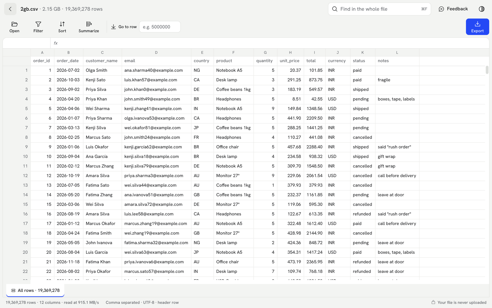
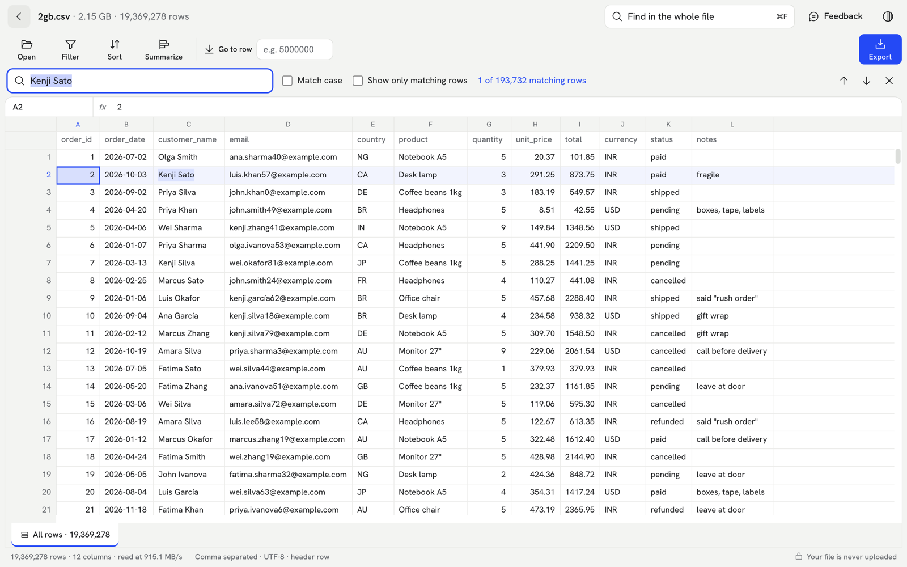
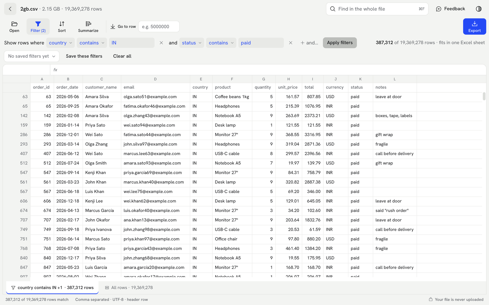
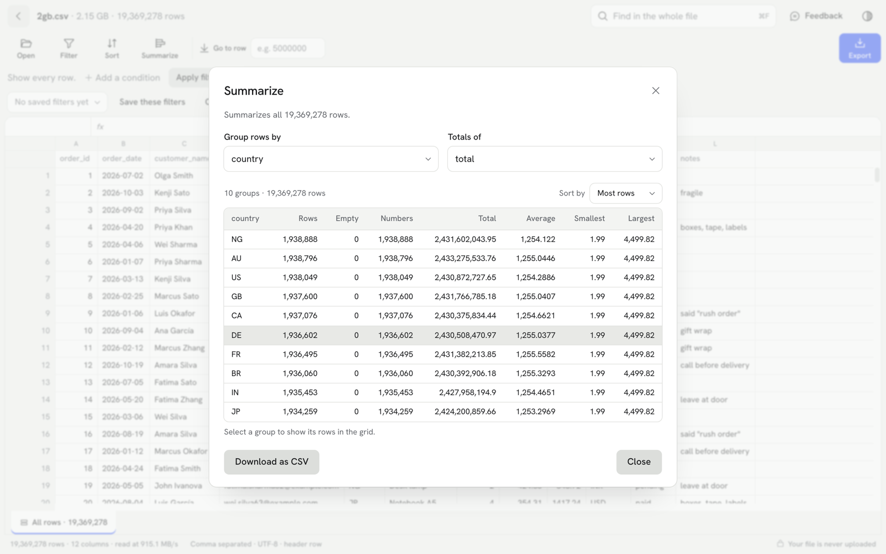
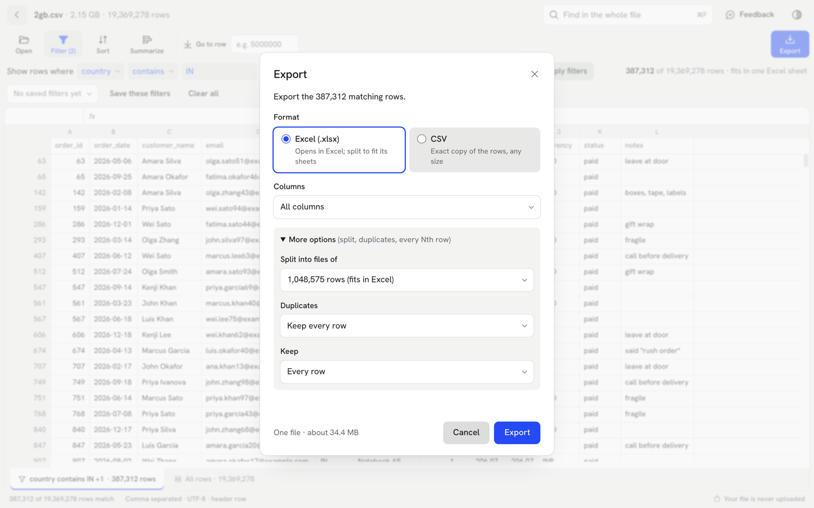
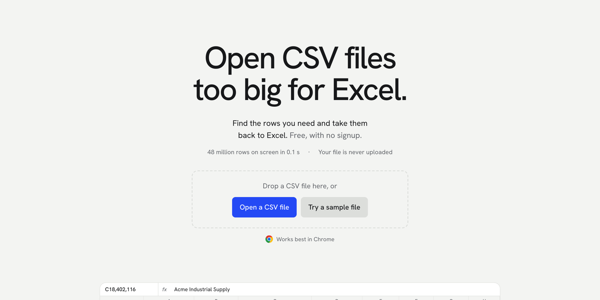
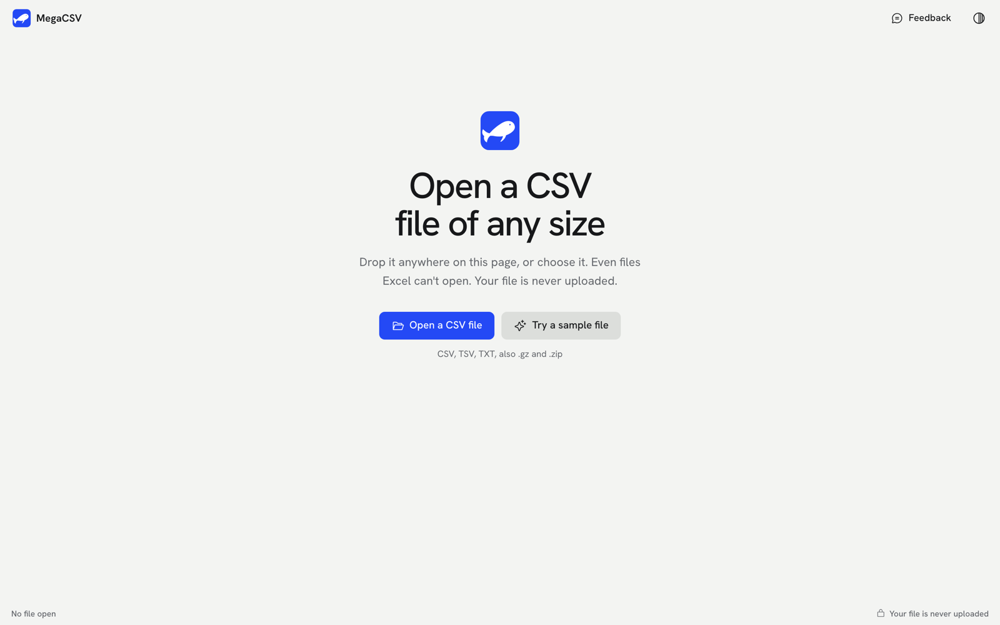

# MegaCSV

**Open CSV files too big for Excel, right in your browser.** Find the rows you need and take them back to Excel. Free, no signup, and your file is never uploaded.

**[megacsv.com](https://megacsv.com)** · [Open the app](https://megacsv.com/app/) · [Try a sample file](https://megacsv.com/app/?sample)



## Why

Excel stops at 1,048,576 rows and silently drops the rest. Google Sheets stops at 10 million cells. Cloud tools want an upload and a signup, and desktop tools need an install that work laptops often block. MegaCSV opens files of tens of gigabytes and hundreds of millions of rows in any modern browser, on your own computer.

| Measured on a MacBook Air (M1, 8 GB), Chrome | |
| --- | --- |
| First rows on screen, 5 GB file | 0.1 s |
| Every row read, 5 GB / 48 million rows | 5.1 s (about 1 GB/s) |
| Opening the same file again | 0.1 s |
| Largest file tested | 20 GB, 192 million rows |
| Memory used | A few hundred MB, whatever the file size |

## Features

- **No row limit.** Scroll, jump to any row (`Go to row`), and see the true row count while the rest of the file is still being read.
- **Find in the whole file.** Match case, jump between matches, or show only matching rows.
- **Filters without formulas.** Build a sentence like *"Show rows where country contains IN and status contains paid"*: contains, equals, one of, starts with, between, empty, not a number. Save filter sets and reuse them.
- **Sort** the whole file by any column.
- **Summarize.** Group by a column and get row counts, totals, averages, smallest and largest values. Click a group to see its rows.
- **Export to Excel or CSV.** Export everything, filtered rows or selected cells. Split into parts that fit Excel (1,048,575 rows), Salesforce (50,000), NetSuite (25,000) or any size. Pick columns, remove duplicates, keep every Nth row.
- **Exact data.** Values show exactly as written: leading zeros, long account numbers and dates are never converted. CSV exports are byte-for-byte copies of the original rows.
- **Instant reopen.** Files you've opened before open again in a fraction of a second. Recent files are remembered in Chrome and Edge.
- **Handles messy files.** Detects the delimiter, encoding and header row. Opens `.csv.gz` and `.zip` too.
- **Spreadsheet feel.** Column letters, row numbers, formula bar, range select and copy, column resize, cell inspector, light and dark themes, touch scrolling.
- **Private by design.** No server ever sees your data. The app makes no network requests with file contents.

## Screenshots

| | |
| --- | --- |
|  **Find** across the whole file |  **Filter** 19M rows down to 387,312 |
|  **Summarize** totals per group |  **Export** to Excel, split to fit |
|  **Homepage** at megacsv.com |  **Start screen** |

## How it works

The trick is to never load the file. MegaCSV reads it in slices, builds a tiny row index once, and from then on reads only the bytes it needs for what's on screen, a search, a summary or an export.

```
                      ┌──────────────── Main thread ────────────────┐
  File (any size) ──▶ │ React UI · canvas grid · controller / state │
   file.slice()       └───────┬────────────────────────────▲────────┘
   ≤16 MB per read            │ jobs (priority queue)      │ small results
                      ┌───────▼────────────────────────────┴────────┐
                      │ Web Worker pool  (one per CPU core)         │
                      │   Rust engine compiled to WebAssembly       │
                      │   scan → index → parse rows → query/export  │
                      └───────┬─────────────────────────────────────┘
                              │ row index, exports
                      ┌───────▼─────────┐
                      │ OPFS (private   │  saved row tables → instant reopen
                      │ browser disk)   │  export staging on Safari/Firefox
                      └─────────────────┘
```

1. **Parallel scan.** The file is cut into chunks and every core scans one. A chunk might start inside a quoted field, and nobody knows until the earlier chunks are done, so each scan records results for *both* starting states (inside and outside quotes) in a single pass. Quote bytes and newlines are located with `memchr`, which uses WebAssembly SIMD (`simd128`).
2. **Stitch.** Chunk results arrive in any order. The stitcher walks them in file order, picks the right starting state for each from the previous chunk's quote parity, and prefix-sums row counts into a sparse index: one checkpoint (byte offset, row number) every 1,024 rows. A 20 GB file needs only a few MB of index.
3. **Show rows on demand.** The canvas grid asks for the rows on screen. The engine binary-searches the nearest checkpoint, reads about 1 MB from there and parses just those rows. Cells are decoded in JavaScript only when painted, and painting happens only in `requestAnimationFrame` when something changed.
4. **Query in the workers.** Find, filters, summaries and sorts stream the file through the same worker pool. Results are compact lists of row offsets, so a filtered view is just another index the grid reads through.
5. **Export without re-serializing.** CSV exports copy the original row bytes. Excel exports are streamed as spreadsheet XML and zipped with `fflate`. Chrome and Edge write straight to disk through the save picker; Safari and Firefox stage the file in OPFS, then download it.
6. **Save the index.** When the scan finishes, the row index is saved in OPFS, valid only while the file's name, size, modified time and first and last 64 KB still match, so the next open skips the scan.

One quote model is shared by the scanner and the row parser (a quote byte always toggles state), so row numbers and displayed rows always agree, even on malformed files.

### Correctness and speed

- The fast scanner is checked against a byte-at-a-time reference (`scan_chunk_naive`) with property tests, and the parser against the [`csv`](https://crates.io/crates/csv) crate.
- Every real-world bug gets a fixture file in `engine/tests/fixtures/`.
- Native benchmark (`tools/bench`): indexing at 2.6–3.7 GB/s on 1–5 GB files with 7 threads. A regression over 10% blocks a change.
- Budgets: WASM under 150 KB gzipped, app JS under 250 KB gzipped.
- Headless Chromium end-to-end tests drive the real app, check exports against `grep`/`awk`/Python, and fail on any request leaving the origin.

## Tech stack

| Part | Built with |
| --- | --- |
| Engine | Rust → WebAssembly (`wasm-bindgen`, `simd128`), `memchr`; tests with `proptest` and `csv` |
| App | TypeScript (strict), Vite, React 19, Tailwind CSS v4, Zustand, hand-built canvas grid, Web Workers |
| Browser APIs | File API slices, OPFS, File System Access API, `DecompressionStream`, IndexedDB |
| Export | Byte-exact CSV writer; XLSX via spreadsheet XML + `fflate` |
| Website | Astro (static, near-zero JS) |
| Hosting | Cloudflare Workers static assets; D1 for the Feedback button |
| Tests | Rust property and fixture tests, Playwright end-to-end tests |

## Project layout

```
engine/   Rust crate compiled to WASM: scanner, index, row parser, queries, XLSX, format sniffing
app/      The app (Vite + TypeScript + React), served at /app/
site/     The website (Astro), served at /
worker/   Cloudflare Worker: serves dist/, handles POST /api/feedback (D1)
tools/    gen-csv test-file generator, native indexing benchmark
```

## Run it locally

Needs Rust (with the `wasm32-unknown-unknown` target), `wasm-bindgen-cli`, `wasm-opt` (Binaryen), Node 22.23+ and pnpm.

```sh
pnpm install
pnpm dev                                       # site at http://localhost:4321, app at /app/
pnpm test                                      # Rust tests
pnpm gen --size 5G --out testdata/5gb.csv      # make a large test file
pnpm bench testdata/5gb.csv                    # indexing benchmark
pnpm build                                     # everything into dist/
```

## License

[MIT](LICENSE) © 2026 Sujal Gupta
